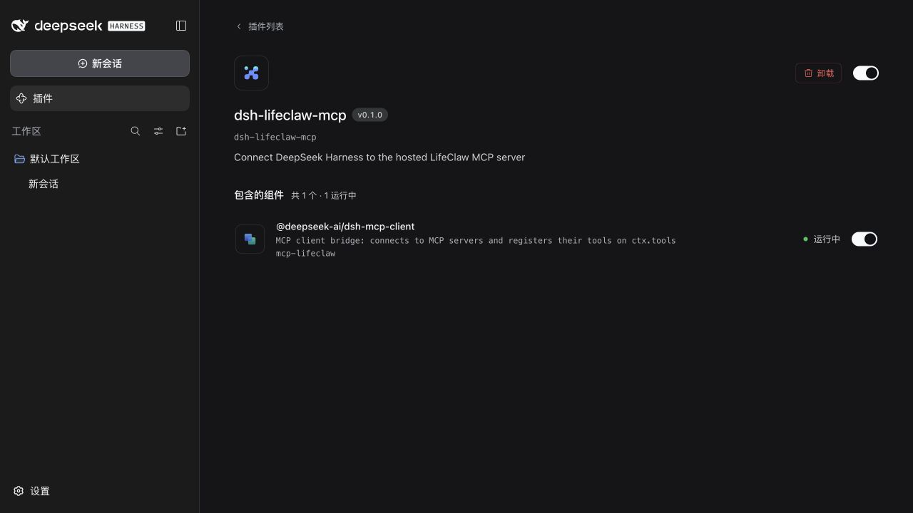

# DeepSeek Harness

This configuration bundle adds the hosted LifeClaw MCP server to a DeepSeek Harness profile through its built-in `@deepseek-ai/dsh-mcp-client`. It contains no LifeClaw server code or credentials.

1. Create a personal API token in [LifeClaw Connections](https://lifeclaw.agentese.ai/chat?settings=tokens).
2. Set `LIFECLAW_API_TOKEN` in the environment that starts DeepSeek Harness. Do not save it in this repository or a profile file.
3. Install the public bundle into the profile you use, then restart that profile:

   ```bash
   export LIFECLAW_API_TOKEN='lc_your_token_here'
   dsh plugin --profile web add github:Manta-Network/lifeclaw
   dsh --profile web --dump-config
   dsh web
   ```

The config dump should include a `dsh-lifeclaw-mcp` layer with an `mcp-lifeclaw` row. In a running session, LifeClaw tools are named `mcp__lifeclaw__<tool>`. Ask the agent to check your account status to confirm the connection without placing a call.

## Example requests

- “Call my verified number when this long-running task finishes and give me a short update.”
- “Find a nearby restaurant and call to ask if it has a table for four tonight.”
- “Call the venue to move my confirmed reservation to 7:30 pm, then report the result.”
- “Show my saved contacts, then call the person I confirm and relay the message I approve.”

For an alert such as “Call me if I haven't acknowledged a critical outage after 10 minutes,” run a workflow that can wait and recheck the alert. The workflow invokes LifeClaw only when the alert is still active and unacknowledged. More examples are in the [main README](../../README.md).



To remove the bundle:

```bash
dsh plugin --profile web remove dsh-lifeclaw-mcp
```

The MCP client evaluates the token environment variable at startup. Restart Harness after setting or rotating it. Calls can consume LifeClaw points; check the recipient and action before approving a phone call.

This is LifeClaw's official integration for DeepSeek Harness, maintained by the LifeClaw team. It is an unofficial DeepSeek Harness community plugin, not a DeepSeek AI product. See the [DeepSeek Harness bundle guide](https://github.com/deepseek-ai/deepseek-harness/blob/master/docs/user/develop/basic/publish.md) and [MCP client configuration](https://github.com/deepseek-ai/deepseek-harness/blob/master/packages/mcp/mcp-client/README.md).
